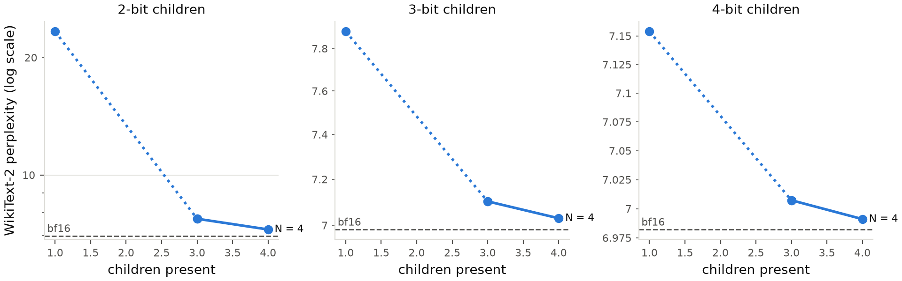
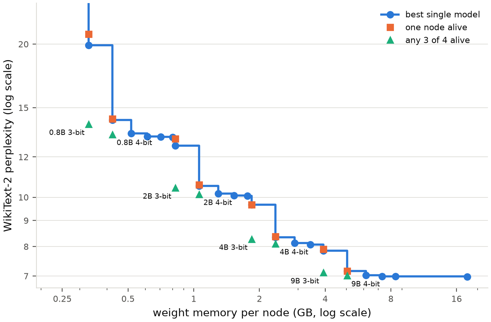

# Syncytium: Research Report

*Overview as of 2026-10-19. This document brings the project together in one place: what was
asked, why, what was run, what came of it, and what it means. It adds no new data. Every
number comes from the detailed reports, the [phase 1 report](results/phase-1-report.md) and
the [swarm report](results/swarm-report.md), which hold the full tables, and from the
per-run summaries under [`results/`](results/).*

## Abstract

A trained language model can be quantized *N* times with the same step size and staggered
rounding offsets. Each copy, a **child**, is an ordinary low-bit model. Together the
children's integer codes add up exactly to the parent quantized on a grid *N* times finer
(Hermite's identity). This project tests whether that makes a **swarm** in which every device
runs its own agent, any group of devices can fuse into a more precise model, and lost members
are rebuilt from the survivors.

On Qwen3.5 Base models from 0.8B to 9B parameters, and post-trained models up to 27B, in
simulation:

- **Children are usable models.** 3- and 4-bit children work on their own from 4B up (from
  2B with channel scaling).
- **Fusion recovers the parent.** Four fused 3-bit children solve 86.1% of GSM8K at 9B
  (bf16: 86.2%) and 82.9% at 4B (bf16: 82.6%). The lone children solve 68–82%.
- **Degradation is gradual and predictable.** Quality falls one step with each lost member,
  and a fused group that loses a member mid-answer finishes the answer without loss.
- **Healing is exact.** Lost members are regrown bit for bit from the survivors, at 0.5 bits
  per weight per child for four children, and less for larger swarms.
- **The swarm can route itself.** When two lone agents give different answers, that tells the
  swarm when to fuse: 92–110% of the fusion gain while fusing on 23–35% of problems,
  confirmed on fresh problems.
- **The swarm survives device loss better than replicated pipelines.** With no backup and
  each device lost with probability 10–30%, its expected accuracy per request beats two
  replicated 6-bit pipelines at both sizes (9B at 30%: 0.839 against 0.703).

The swarm is **not efficient**. A 6-bit model pipelined over the same four devices matches
its accuracy at several times its throughput. The project's claim is therefore **survival**:
the swarm keeps answering with whatever is left and returns to full health with no backup.
The pre-registered test of that claim against replicated pipelines (H12b) holds at both
sizes. One scale prediction failed: 2-bit children are still not usable alone at 27B (2.0x
bf16 perplexity against a 1.5x bar), though four of them rebuild the model within 0.23.

## 1. The problem

A deployed LLM is usually one artifact on one host. The two standard ways to protect it each
give something up:

| | Serves during an outage | Memory per node | Gains from more nodes | Recovers the model |
|---|---|---|---|---|
| **Replication** | Yes | A full model each | No | Yes, from any copy |
| **Erasure coding** | No: shards are inert bytes | A fraction | — | Yes, exactly, from any *k* of *N* |
| **Staggered children** (this project) | Yes: every shard is a model | A fraction | Yes: quality rises with each member | Yes, exactly, from the survivors |

The starting question was whether shards can be **functional**: each one a usable model on a
small device, while all of them together rebuild the high-precision parent. Phase 1 answered
it, and the answer raised a larger question. If every shard is a model, the set is not a
backup at all. It is a **swarm** of agents that can also act as one model. Phase 2 asked what
such a swarm can do.

The target setting is hardware that fails often: phones, laptops, edge boxes and volunteer
machines, which are often unavailable more than a tenth of the time. A datacenter, where
devices fail far below 1% of the time, is better served by an ordinary pipeline. Part of this
study's job was to establish that boundary honestly.

## 2. The approach

The full derivations are in the [method](method.md). In short:

1. **Staggered quantization.** Weights are quantized in groups of 64, with a shared minimum
   *m* and step Δ. Child *k* rounds with offset (*k* + φ)/*N*. Each child is an ordinary
   *b*-bit model with worst-case error Δ/2.
2. **Exact rebuild.** By Hermite's identity, the children's codes sum to the parent's code on
   a grid of step Δ/*N*, with worst-case error Δ/(2*N*). The rebuild is integer arithmetic,
   checked by SHA-256. Four 3-bit children give a parent of about 5 bits.
3. **Partial rebuild.** Any subset of children bounds each weight to an interval. The error is
   set by the largest gap between the surviving offsets, so *which* children survive matters
   as well as how many.
4. **Fusion.** The parent's weights are the mean of the children's, and linear layers are
   linear in their weights. So a group of devices can run the parent together by averaging
   outputs at every linear layer, without any device holding parent weights. A partial group
   runs the mean of its members.
5. **Regrowth.** Every child is a fixed function of the parent's code. A small amount of
   stored data lets the survivors regrow a lost child exactly: either one bit per ambiguous
   weight, or an erasure-coded residue for many losses at once.
6. **Quantizer improvements that compose.** A shared Hadamard rotation and AWQ-style
   activation-aware channel scaling are linear and identical in every child, so the rebuild
   identity survives both. GPTQ-style error feedback does not compose and is out of scope.

Each child stores *b* + 0.5 bits per weight at *g* = 64: 3.5 bits for a 3-bit child, 4.6x
smaller than bf16. Memory figures always include scales and every unquantized tensor.

## 3. How the research proceeded

The project ran in two phases over three days (2026-10-16 to 2026-10-18). Each step was
prompted by the open question the previous one left.

| Step | Question | Why it was asked | Outcome |
|---|---|---|---|
| **0.8B pilot** | Does the scheme work end to end? | Cheapest test of the identity on a real model. Thresholds for the larger runs were fixed afterwards and before any of them was examined. | Works. 4-bit children usable; 3-bit not at this size. |
| **2B, 4B, 9B sweeps** (H1–H4) | Does it hold as models grow? | Usefulness depends on size; protection matters most for large models. | Holds, and improves with size: 3-bit children usable from 4B. |
| **Baselines and equal memory** | Why not replicate, erasure-code, or run a smaller model? | The obvious objections to any new scheme. | No baseline dominates. A fleet of children beats any single model that fits on one node. |
| **Channel scaling** (stage 1.9) | Why not use a better quantizer? | Staggering must not be a substitute for good quantization. | They stack. Scaling improves every child and rebuild. |
| **Survivor counts, pooled pipeline, seeds, demo scheme** | Are the phase 1 claims robust? | Several claims rested on one seed, one size or one survivor count. | Mostly yes. One claim corrected (the 3-bit "within 0.05" held for only one seed). |
| **Reframe to a swarm** (H7–H17) | What can a set of functional shards *do*? | If every shard is a model, the set is a swarm, not a backup. | Pre-registered before any task data existed. |
| **Gate A: tasks** (H7, H8, H11, H13) | Does fusion help on real tasks? Does the swarm survive losses? | Perplexity differences of hundredths may or may not change answers. | Fusion recovers the parent's accuracy. Entropy fails as a routing signal. |
| **Speed model** (H9) | Is fused serving fast enough? | Fusion needs 130 averaging rounds per token. | Borderline. Passes at 9B, fails at 4B. |
| **Regrowth** (H14, H15) | Can survivors heal the swarm exactly? | Approximate repair was shown to drift. | Exact, with no drift, at small storage cost. |
| **Disagreement routing** (H8b, H10b) | Is there a cheap signal for when to fuse? | Found after the fact once H8 failed, so it had to be confirmed on fresh data. | Confirmed. But a static split is still faster. |
| **Survival** (H12b) | Does the swarm beat replicated pipelines under device loss? | After H10b, survival is the only claim left. | Holds at both sizes for 10–30% device failure. The pipelines stay faster. |
| **Post-trained series** (H17) | Do 2-bit children become usable at 27B? | Fusion should matter more as models grow. | Fails: 2.0x bf16 at 27B. The trend is real but slower than predicted. |

**How claims were kept honest.** Every hypothesis and threshold was committed before the
data it governs existed. Clarifications are dated and kept in each pre-registration's
"Changes after fixing". Where a design was chosen after seeing related data, the
pre-registration says so (see [limitations](#7-limitations-and-threats-to-validity)).
Failures stand with their registered consequences: when H8 failed, H10 was dropped and not
revisited. Corrections are made in the reports where the claim appeared.

## 4. Results

### 4.1 Children are usable models, and the set rebuilds the parent (H1–H3)

Worst child as a multiple of bf16 perplexity, and the full four-child rebuild's gap to bf16.
*N* = 4, φ = ½, rotated and channel-scaled (WikiText-2 test):

| | 0.8B | 2B | 4B | 9B |
|---|---:|---:|---:|---:|
| Worst 4-bit child | 1.09x | 1.05x | 1.04x | 1.03x |
| Worst 3-bit child | 1.59x ❌ | **1.30x** | 1.20x | 1.13x |
| Worst 2-bit child | 391x ❌ | 46x ❌ | 12x ❌ | 3.7x ❌ |
| 4-bit rebuild gap | 0.05 | 0.03 | 0.02 | 0.01 |
| 3-bit rebuild gap | 0.29 | 0.14 | 0.08 | 0.05 |
| 2-bit rebuild gap | 1.66 ❌ | 0.79 ❌ | **0.44** | **0.27** |

The bars are 1.5x for a usable child (H2) and 0.5 for a near-lossless rebuild (H3). The
rebuild identity (H1) is exact and verified by hash.

- Usability improves with size, but the 3-bit ratio levels off between 4B and 9B without
  scaling (1.31–1.40x and 1.32–1.41x).
- 2-bit children are never usable alone. With scaling, though, four of them rebuild the 4B
  and 9B models within 0.5 of bf16. Even unusable children carry the parent's information.

### 4.2 A better quantizer stacks on top (stage 1.9)

Channel scaling improves every child, rebuild and single model, and the rebuild stays exact.
At 9B it takes the worst 3-bit child from 1.33x to 1.13x bf16. It also makes the children of
a set nearly interchangeable: 7.86–7.90 at 9B 3-bit, against 8.88–9.27 unscaled.

With scaling and rotation, the worst child trails the same-size single round-to-nearest model
by at most 0.014 at 4 bits across three rotation seeds, and by 0.05–0.09 at 3 bits. That gap
is the whole cost of the scheme for the last node standing.

### 4.3 Degradation is strict, and predictable from offsets (H4, H6)

- **More is always better.** At 0.8B and 4B, the worst rebuild from any *k* + 1 of four
  children beats the best from any *k*, in all twelve settings at each size.
- **Which survive matters.** Two children with offsets ½ apart rebuild far better than two
  adjacent ones (4B, 3-bit, scaled: 8.39–8.40 against 8.63–8.68), as the partial-rebuild
  bound predicts.
- **Pooled pipelines (H6).** Five stages, each held by four devices. Losing any one device
  costs at most 0.22 perplexity at 2B. The cost of any loss pattern is the sum of each
  affected stage's own cost, with R² = 0.999–1.000.

### 4.4 A fleet of small nodes beats any single model that fits on one (stage 1.8)

At the weight memory of one child, any three of four scaled children rebuild a better model
than the best single model of any measured size that fits. This holds in every setting at
every size, 2-bit included. Four 2.8 GB nodes holding 2-bit 9B children rebuild to 7.25;
the best model that fits in 2.8 GB scores 8.34.

Against simpler schemes on the same nodes:

- Replication wins only when a single node is left, by 0.05 or less with scaling at 4B and
  9B. To match the children with three of four nodes alive, it needs about 2 more bits per
  node.
- An erasure-coded remainder rebuilds the exact parent from any *k* nodes, at log₂(*N*)/*k*
  extra bits per node.
- Staggered children are the only scheme whose quality rises with every surviving node at no
  extra memory, and the only one whose shards can cooperate without being decoded first.

### 4.5 Fusion recovers the parent's task accuracy (H7, H11, H13)

GSM8K test, 1,319 problems, 8-shot chain of thought, greedy decoding. 3-bit children,
*N* = 4, φ = ½, rotated and scaled:

| | 9B | 4B |
|---|---:|---:|
| bf16 | 86.2% | 82.6% |
| Lone children | 76.8–81.8% | 68.0–74.2% |
| Mean over groups of 2 / 3 | 84.1% / 85.0% | 79.1% / 81.4% |
| **Four fused** | **86.1%** | **82.9%** |
| Share of the gap to bf16 recovered (H7, bar 50%) | 98% | 102% |
| A member lost mid-answer, minus three from scratch (H13, margin −2) | +0.9 points | +1.4 points |

- **H7.** McNemar *p* = 5 × 10⁻¹⁸ (9B) and 5 × 10⁻³² (4B).
- **H11.** Mean accuracy rises with each member, and the worst group of three beats the best
  lone child.
- **H13.** Losing a member halfway through costs nothing. The half written by the full group
  helps the survivors finish.
- **MMLU** (exploratory). The gain carries over to knowledge questions but is smaller:
  children score 66–70% and four fused 70.8% (9B) and 72.8% (4B), against bf16's 71.9% and
  73.0%.

### 4.6 Healing is exact and cheap (H14, H15)

Storage per child, in bits per weight. A 3-bit child is about 3.5:

| | *N* = 4 | *N* = 8 | *N* = 16 | *N* = 100 |
|---|---:|---:|---:|---:|
| Neighbour bits (any losses with no two adjacent) | 0.50 | 0.25 | 0.125 | 0.02 |
| Coded residue, *t* = 1 | 0.67 | 0.43 | 0.27 | 0.07 |
| Coded residue, *t* = *N*/2 | 1.00 | 0.75 | 0.50 | 0.14 |

- **Exact, with no drift.** Every allowed loss pattern regrows files that match their recorded
  hashes. Ten rounds of loss and regrowth leave the parent hash unchanged (215 unit tests,
  *N* = 4, 8 and 16).
- **Off the serving path.** The data lives on disk next to the shards and is never loaded for
  serving.
- **Guessing fails (negative control).** At *N* = 4, a quarter of the guessed codes come out
  wrong and the set's rebuild error grows 4x. After five rounds it has grown more than 100x.

### 4.7 Routing: one agent's entropy fails, two agents' disagreement works (H8, H8b)

| Signal | Escalated | Gain recovered, 9B | Gain recovered, 4B | Verdict |
|---|---:|---:|---:|---|
| Highest mean token entropy (H8) | 30% | 36% | 42% | ❌ bar 50% |
| Two lone agents disagree (H8b), fresh problems | 23–35% | **107–110%** | **92–100%** | ✅ bar 75% at ≤ 50% |
| Random escalation | same rate | ≈ rate | ≈ rate | control |

At 9B, the disagreement policy is more accurate than always fusing (88.2–88.5% against
87.6%). When two members agree, they are right slightly more often than the group.

### 4.8 The cost: fusion is slow (H9, H10b)

- **H9.** Under the pre-registered network model (0.2 ms, 1 Gbit/s, 100 GB/s devices), four
  fused devices reach 35% of one solo device's speed at 9B, which passes the 25% bar. At 4B
  they reach 23%, which fails: a smaller child is read faster, so communication weighs more.
- **H10b.** Static splits of the same four devices, using the same disagreement router, are at
  least as accurate and faster. At 9B the swarm reaches 88.3% at 21.9 problems/s per answer
  token, against 88.0% at 54.4 for a 6-bit pipeline on all four devices.
- **Why.** A fused token costs about six times the device time of the 6-bit pipeline (449
  against 74 device-ms at 9B). Every device reads a whole child per token, and the devices
  exchange about 3.4 MB per token.

### 4.9 Survival under device loss (H12b)

Four devices, no backup, each lost with probability *p*. The swarm fuses every live member;
two 6-bit pipelines, each stage held by two devices and cross-routed, answer when every stage
has a live copy. Expected accuracy per request, with unanswered requests counted as wrong:

| *p* | 9B swarm | 9B pipelines | 4B swarm | 4B pipelines |
|---:|---:|---:|---:|---:|
| 0.1 | **0.856** | 0.832 | **0.822** | 0.811 |
| 0.2 | **0.850** | 0.783 | **0.813** | 0.762 |
| 0.3 | **0.839** | 0.703 | **0.797** | 0.685 |

- **H12b holds at both sizes** (bar: the swarm wins at *p* = 0.1, 0.2 and 0.3). The pipelines
  answer only 98%, 92% and 83% of requests at those rates; the swarm answers 99–100%.
- **It does not depend on a weak 6-bit model.** The 6-bit model scored 84.9% on GSM8K test at
  9B, 1.3 points under bf16, but matched bf16 on train problems and beat it on MMLU. Had it
  matched bf16, H12b would still pass.
- **Throughput still favours the pipelines**, by 4.8x (9B) and 7.3x (4B) in correct answers
  per second at *p* = 0.1.
- **Restoring full health** at *p* = 0.1: neighbour bits 96.4%, replicated pipelines 98.0%,
  coded residue with *t* = 2 99.6%.

### 4.10 Scale: the post-trained series (H17)

Qwen3.5 has no 27B Base model, so the trend was measured on post-trained checkpoints at every
size. Worst child as a multiple of bf16 perplexity, scaled and rotated:

| | 0.8B | 2B | 4B | 9B | 27B |
|---|---:|---:|---:|---:|---:|
| 2-bit | 417x | 84x | 18x | 4.2x | **2.02x** ❌ |
| 3-bit | 1.60x | 1.33x | 1.22x | 1.14x | 1.11x |

- **H17 fails** (bar 1.5x at 27B). The usable bit width falls with size, but not fast enough
  for 2-bit children to work alone at 27B.
- **The 2-bit fleet works.** Four 2-bit 27B children of 8.4 GB each rebuild within 0.23 of
  bf16.
- **Post-training barely matters.** At 3 bits the post-trained and Base series agree within
  0.03x at every size.

## 5. Conclusions and why they matter

**1. Functional shards break the trade-off between replication and erasure coding.**
*Evidence:* children within 3–20% of the parent's perplexity at 4B and 9B, an exact
hash-checked rebuild, and quality that rises with every member (§4.1, §4.3, §4.4).
*Why it matters:* until now, protecting a model meant choosing between paying for full
replicas, which serve during an outage, and storing cheap coded shards, which serve nothing
until decoded. Staggered children give both properties at the memory cost of one low-bit
model per node, with no training.

**2. Staggering is orthogonal to quantizer quality.**
*Evidence:* rotation and channel scaling improve children, rebuilds and single models
together, and the last node standing trails the same-size single model by at most 0.014 at
4 bits (§4.2).
*Why it matters:* the scheme is not competing with the quantization literature, it rides on
it. Any future linear, shared improvement to quantization carries over to every child and
every fused group. That makes the scheme a structural choice rather than a point on today's
quality curve.

**3. Degradation is predictable, so it can be engineered.**
*Evidence:* any *k* + 1 children beat any *k*, opposite offsets beat adjacent ones, and
pooled loss costs add across stages with R² ≈ 1 (§4.3).
*Why it matters:* operators get two concrete rules. **Placement:** each failure domain should
hold evenly spaced offsets (children 0 and 2 together, 1 and 3 together). **Reporting:** a
control plane can state the expected quality of any device state from a small table, with
no evaluation at run time. A failing system is then something to reason about, not
something to discover.

**4. Fusion turns precision back into task accuracy, and perplexity understates the stakes.**
*Evidence:* four fused 3-bit children match bf16 on GSM8K at both sizes. Children whose
perplexities differ by hundredths differ by 5–6 points on GSM8K (§4.5).
*Why it matters:* the parent's reasoning ability survives being split into 3-bit pieces and
comes back on demand. Separately, perplexity alone is a poor guide to how quantized models
behave as agents. Task-level evaluation is necessary for any claim about quantized agents.

**5. Self-healing has to be exact, and exact is cheap.**
*Evidence:* hash-exact regrowth at 0.5 bits per weight per child for *N* = 4, falling to
0.14 for *N* = 100 surviving 50 simultaneous losses. Guessing grows the error more than 100x
over five rounds (§4.6).
*Why it matters:* the swarm returns to full health with no backup anywhere, and the storage
cost shrinks as the swarm grows, which is the regime the design is for. The negative control
is a general lesson for distributed models: approximate repair compounds, so any
self-repairing system needs a correctness check, here a hash, not a quality heuristic.

**6. The swarm's diversity is a feature: it can route itself.**
*Evidence:* two lone agents disagreeing recovers 92–110% of the fusion gain while escalating
23–35% of problems, confirmed on fresh problems. Entropy recovers only 36–42% (§4.7).
*Why it matters:* deciding when to spend expensive compute is the central problem of any
cascade of models. Identical replicas decoding greedily always agree, so they cannot produce
this signal. Staggered children differ by construction, so the swarm gets a strong, cheap
router for free from the same property that makes it robust.

**7. The swarm is not efficient, but it survives.**
*Evidence:* H9 is borderline (passes at 9B, fails at 4B), and H10b fails at both sizes: a
6-bit pipeline is several times faster at similar accuracy (§4.8). Under device loss with no
backup, though, the swarm's expected accuracy per request beats replicated pipelines at
every failure rate from 10% to 30%, at both sizes (§4.9).
*Why it matters:* this decides where the idea belongs. On reliable hardware, a pipeline is
the right tool. On hardware that fails often (phones, edge boxes, volunteer machines) the
swarm answers more requests, and answers them well, because any surviving member can serve
and fused survivors stay accurate. That is a narrower claim than "a better way to serve
models", and it is the one the evidence supports.

**8. Bit width is the main design dial.**
*Evidence:* at 4 bits a lone child is nearly the parent, so fusing adds little (9B scaled:
7.16 → 6.99). At 3 bits fusing recovers most of the gap (7.90 → 7.03). At 2 bits children
only work as a fleet (§4.1).
*Why it matters:* the same mechanism covers three deployments:
- **4-bit:** cheap insurance, where every survivor is nearly as good as the parent.
- **3-bit:** a true swarm, where solo agents are usable and fusing pays.
- **2-bit:** fleet-only, where devices jointly run a model none of them could hold. Four
  2.8 GB nodes run a 9B model at 7.25 perplexity.

**9. Larger models help, but more slowly than hoped.**
*Evidence:* the worst 2-bit child falls from 417x bf16 perplexity at 0.8B to 2.0x at 27B,
missing H17's 1.5x bar; 3-bit children improve to 1.11x (§4.10).
*Why it matters:* the direction holds, so a swarm becomes more capable per bit as models grow.
But 2-bit swarms with usable individuals need models beyond 27B, and that is an
extrapolation no Qwen3.5 dense model can test. At 27B, the 3-bit swarm is the natural
configuration: 11.8 GB per member, each at 1.11x bf16.

## 6. Negative results and corrections

These are reported as prominently as the positive results, because each changed what the
project claims.

| Result | Consequence |
|---|---|
| H8 failed: entropy is a weak escalation signal | H10 dropped as registered; disagreement found and confirmed separately (H8b) |
| H9 failed at 4B (23% against a 25% bar) | Fused serving is only "fast enough" for larger children on wired LANs |
| H10b failed at both sizes | The efficiency claim was abandoned; the project now rests on survival (H12b) |
| The 3-bit "within 0.05 of RTN" claim held for one rotation seed only (0.05–0.09 across three) | Corrected in the phase 1 report; differences below about 0.03 between single 9B models cannot be ranked |
| The 3-bit usability ratio stops improving from 4B to 9B (unscaled) | "Bigger is better" was not extrapolated past 9B; H17 then tested it at 27B |
| H17 failed: the worst 2-bit child is 2.02x bf16 at 27B (bar 1.5x) | 2-bit swarms stay fleet-only through 27B; the registered 27B GSM8K follow-up was not run |
| Neighbour bits restore full health less often than replicated pipelines (96.4% against 98.0% at 10% failure) | Survival in answering does not imply survival in storage; the coded residue (*t* = 2) is needed to beat replication there |
| 2-bit children are unusable alone at every size | 2-bit is a fleet-only configuration; a router must never send a request to a lone 2-bit child |
| On MMLU at 9B, some groups of two and three beat the full group (up to 71.2% against 70.8%) | Within noise; the MMLU fusion gain is smaller than on GSM8K and is exploratory only |

## 7. Limitations and threats to validity

- **Simulation, not systems.** Fused groups are simulated by swapping averaged weights into one
  model, which is exact for quality but says nothing about speed. Speed comes from a model of
  rounds, bytes and memory bandwidth that ignores compute, KV-cache reads and overlap. No
  result here was measured on real devices or networks.
- **Narrow coverage.** One model family (Qwen3.5), Base checkpoints, and two sizes (4B and 9B)
  for task results. Tasks are GSM8K and MMLU only, with greedy decoding, one run and rotation
  seed 0.
- **Sampling noise.** On 1,319 problems one accuracy has a standard error of about 1 point.
  Paired tests (McNemar, the paired H13 interval) are much tighter for comparisons within a
  run. But "4B fused beats bf16" (+0.3 points) is noise, not a finding.
- **Disagreement routing was found after the fact.** It was discovered on the test answers,
  then confirmed on GSM8K *train* problems 64–1,382. Base models may have seen GSM8K train
  data: accuracies there run 1–2 points higher than on test. The confirmation compares
  conditions within the same split, so the recovered share is unaffected, but its absolute
  accuracies are not comparable with the test-split numbers.
- **H12b's design followed an estimate.** Its pass range (*p* = 0.1–0.3) was set after an
  estimate from Gate A's numbers put the 9B crossover near *p* = 0.05, and before it was
  committed the 6-bit model was seen to match bf16 on train problems. The pre-registration
  discloses both. H12b passed, but it is weaker evidence than H7 and should be read with its
  full curve. In particular, the swarm's lead below *p* = 0.1 comes from the 6-bit model
  scoring 1.3 points under bf16 on the test problems, which is within noise.
- **Failures are modelled as independent.** H12b weights every device state by independent
  loss probabilities over a window with no repair. Correlated failures (a shared power supply
  or network switch) and repair during the window are not modelled. The placement rule (§4.3)
  is the first defence against correlation.
- **H17 rests on post-trained models only**, because no 27B Base exists. The post-trained and
  Base series agree closely where both exist.
- **The best configurations are not yet deployable.**
  - The shard format cannot store channel scales, so the swarm console runs unscaled children.
  - llama.cpp has no kernels for rotated weights or for 2- and 3-bit block formats.
- **Memory counts weights only.** The KV cache is not included, and channel scales (under
  0.006 bits per weight) are left out.

## 8. What comes next

Every pre-registered decisive test has now run. In order of how much each would add:

1. **A 3-bit swarm at 27B.** The natural configuration at the largest size (11.8 GB per
   member, each at 1.11x bf16): does fusion still recover the parent on GSM8K, and does
   disagreement still route? It needs its own pre-registration, with a protocol for a
   post-trained model.
2. **Correlated failures.** H12b assumes independent device loss. Failure domains (shared power
   or switches), with and without the placement rule, would show how much the survival claim
   depends on that assumption.
3. **H16, fusion partners at *N* = 16.** Whether a large swarm should fuse with evenly spaced
   partners rather than any available ones. Not yet run.
4. **Channel scales in shards.** This would make the best measured configuration deployable
   in the console and the container demo.
5. **Real devices and networks.** Tokens per second, bytes per token and time to recover a
   member, measured against the H9 model. This is follow-up systems work, outside this study.

## 9. Status of every hypothesis

| Hypothesis | Outcome | Source |
|---|---|---|
| H1 exact superposition | Holds (unit tests, hash match on real shards) | [Phase 1](results/phase-1-report.md#h1-exact-superposition-holds) |
| H2 functional children | Holds at 4 bits everywhere; at 3 bits from 4B (from 2B with scaling) | [Phase 1](results/phase-1-report.md#h2-functional-children-holds-at-4-bits-everywhere-at-3-bits-from-4b) |
| H2a rotation helps low-bit children | Holds for children, not rebuilds | [Phase 1](results/phase-1-report.md) |
| H3 near-lossless rebuild | Holds whenever the parent has about 5+ bits | [Phase 1](results/phase-1-report.md#h3-near-lossless-rebuild-holds-whenever-the-rebuild-has-about-5-bits) |
| H4 graceful degradation | Holds, including every survivor count at 0.8B and 4B | [Phase 1](results/phase-1-report.md#h4-graceful-degradation-holds-including-with-two-children-missing) |
| H5 wipe and rebuild the main container | Superseded by H13–H15 | [Swarm pre-registration](preregistration-swarm.md) |
| H6b, H6c pooled pipeline | Hold at 0.8B and 2B | [Swarm report](results/swarm-report.md#phase-1-follow-ups) |
| Seed robustness ("within 0.05") | Holds at 4 bits, fails at 3 bits | [Swarm report](results/swarm-report.md#phase-1-follow-ups) |
| Survivor ordering and pairs at 4B | Hold | [Swarm report](results/swarm-report.md#phase-1-follow-ups) |
| H7 fusion changes answers | Holds at 9B and 4B | [Swarm report](results/swarm-report.md#h7-fusion-changes-answers-holds) |
| H8 entropy escalation | Fails at 9B and 4B | [Swarm report](results/swarm-report.md#h8-a-lone-agent-knows-when-to-ask-fails) |
| H8b disagreement escalation | Holds at 9B and 4B, on fresh problems | [Swarm report](results/swarm-report.md#escalation-on-disagreement-confirmed-h8b-but-not-efficient-h10b) |
| H9 fused speed | Holds at 9B, fails at 4B | [Swarm report](results/swarm-report.md#h9-fused-serving-is-fast-enough-holds-at-9b-fails-at-4b) |
| H10 elasticity (entropy router) | Dropped, as registered after H8 failed | — |
| H10b elasticity (disagreement router) | Fails at 9B and 4B, as expected when registered | [Swarm report](results/swarm-report.md#escalation-on-disagreement-confirmed-h8b-but-not-efficient-h10b) |
| H11 task-level degradation | Holds at 9B and 4B | [Swarm report](results/swarm-report.md#h11-graceful-task-level-degradation-holds) |
| H12 survival under churn | Superseded by H12b | [Survival pre-registration](preregistration-survival.md) |
| **H12b survival against replicated pipelines** | **Holds at 9B and 4B** (10–30% failure) | [Swarm report](results/swarm-report.md#survival-under-device-loss-holds-h12b) |
| H13 loss mid-answer | Holds at 9B and 4B | [Swarm report](results/swarm-report.md#h13-surviving-a-members-loss-mid-answer-holds) |
| H14, H15 exact regrowth, no drift | Hold | [Swarm report](results/swarm-report.md#h14-and-h15-exact-regrowth-without-drift-hold) |
| H16 fusion partners, *N* = 16 | Not run | [Swarm pre-registration](preregistration-swarm.md) |
| H17 27B (post-trained series) | Fails: worst 2-bit child 2.02x bf16 (bar 1.5x) | [Swarm report](results/swarm-report.md#scale-the-post-trained-series-h17-fails) |

## 10. Where everything lives

| To find | Go to |
|---|---|
| The mechanism, with derivations | [Method](method.md) |
| Perplexity results, baselines, channel scaling | [Phase 1 report](results/phase-1-report.md) |
| Task results, speed, regrowth, routing | [Swarm report](results/swarm-report.md) |
| What was predicted, and when | [H1–H6](hypothesis.md), [H7–H17](preregistration-swarm.md), [H8b, H10b](preregistration-disagreement.md), [H12b](preregistration-survival.md) |
| Stages, risks and decisions | [Plan](plan.md) |
| Per-run tables and figures | `docs/results/<run>/` (written by the report commands) |
| Raw outputs, every answer, configs and commits | `results/<run>/` (not in git) |
| Running on the cluster | [Cluster guide](cluster.md) |
| Branches of this study | [Future work](future-work.md) |

`syncytium-runs` lists every configured run, how far it got, and whether it is reported.
Every run records its config, git commit, package versions, device and SLURM job in
`results/<run>/runs.jsonl`.
